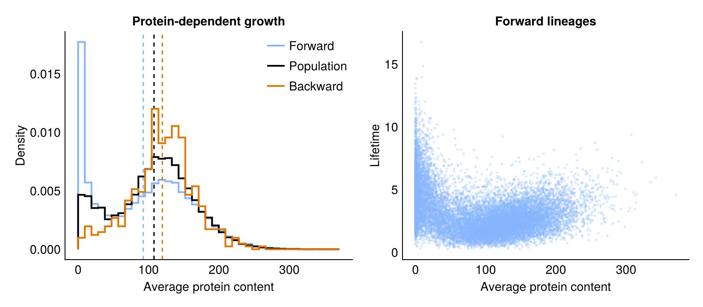
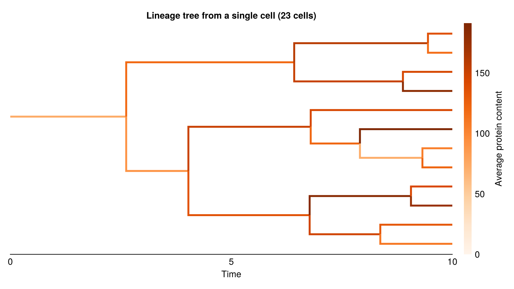

# Protein-Dependent Growth

This model is inspired by Piho & Thomas, "Feedback between stochastic gene networks and population
dynamics enables cellular decision-making", Sci. Adv. (2024).

A gene `G` switches on and off at random, and while on, it produces a protein `P`
in bursts. The protein `P` in turn increases the growth rate of the cell, which causes
cell-to-cell variability in growth rates. We can implement this in [Catalyst.jl](https://docs.sciml.ai/Catalyst/stable/) as follows:

````julia
using Catalyst
using Distributions
import Distributions: Geometric

@register_symbolic Geometric(p)     # allows random burst sizes in reactions
@parameters b
burst_size = rand(Geometric(1 / (1 + b)))

rn = @reaction_network begin
    @species G_on(t) G_off(t) P(t)
    @variables R(t)                       # time to division
    @parameters k_on k_off f K n r_max

    k_on, G_off --> G_on
    k_off, G_on --> G_off
    f, G_on --> G_on + $burst_size * P    # protein production

    @equations begin
        D(R) ~ -(1 + hill(P, r_max - 1, K, n))
    end
end

p = [ :k_on => 0.05, :k_off => 0.05,      # gene switching rates
      :f => 10.0, :b => 4.0,              # burst frequency while the gene is on, and mean burst size
      :K => 30.0,                         # protein number at half-maximal growth rate
      :n => 4,                            # Hill coefficient of the growth rate
      :r_max => 2.0 ]                     # maximal growth rate

cycle = Gamma(5, 1.0);                    # cell cycle duration in the absence of protein
````

## Division

A cell divides once its remaining lifetime `R` reaches 0. When it divides,
proteins are partitioned binomially between the two daughters.

````julia
using Chemostats
using Chemostats: Offspring, BinomialPartition

cb_div = Chemostats.DivideCallback(rn.R ~ 0)

divide_cell = Offspring(2, :P => BinomialPartition(), :R => cycle);
````

We tell Chemostats to record the average protein content by overriding
`Chemostats.get_data`:

````julia
using StatsBase: ProbabilityWeights

function Chemostats.get_data(cell::DECell{I,typeof(divide_cell)}) where {I}
    sol = cell.int.sol
    mean(sol[:P][1:end-1], ProbabilityWeights(diff(sol.t)))
end;
````

We create a HybridProblem to simulate the cells. The remaining time `R` follows an ODE,
and the gene state and protein number changes by jumps.

````julia
using OrdinaryDiffEqTsit5
using JumpProcesses

u0 = [ :G_on => 1, :G_off => 0, :P => 30, :R => mean(cycle) ]
prob = HybridProblem(rn, u0, (0., Inf), p; callback = cb_div)

create_population(L) = [ DECell(prob, Tsit5(), divide_cell) for _ in 1:L ];
````

## Simulating populations

We first simulate `L` individual lineages using `Chemostats.Forward`,
and then a population of `L` competing lineages using `Chemostats.Strict`.
In both cases we record the entire lineage tree with `save_mode = :full`.

````julia
L = 50
tmax = 1000.0

chem_fwd = Chemostats.simulate(create_population(L), tmax, Chemostats.Forward(L); save_mode = :full)
chem = Chemostats.simulate(create_population(L), tmax, Chemostats.Strict(L); save_mode = :full);
````

````
┌ Warning: Population trees are not currently supported with cloning. Use Strict(L, false) to disable cloning
└ @ Chemostats ~/work/Chemostats.jl/Chemostats.jl/src/algorithms.jl:93

````

The data we stored for each node is the average protein content of the cell.
We obtain a backward lineage by tracing the ancestors of a living cell.

````julia
means_fwd = [ node.data for node in values(chem_fwd.tree) ]
means_pop = [ node.data for node in values(chem.tree) ]
means_bwd = [ node.data for node in Chemostats.ancestors(chem.tree, first(chem.pop)) ]

(forward = mean(means_fwd), population = mean(means_pop), backward = mean(means_bwd))
````

````
(forward = 92.48834655172125, population = 107.8253592971131, backward = 119.60431628582907)
````

We see that forward, population and backward statistics are all different. Cells that produce
more protein divide faster, and are thus overrepresented in the population and in ancestral
lineages.

We next compare cell lifetimes with average protein content. Here we ignore cells that are currently
alive and have not yet divided.

````julia
divided = filter(!Chemostats.is_alive, chem_fwd.tree)
lifetimes = [ Chemostats.lifetime(node) for node in divided ]
means_div = [ node.data for node in divided ];
````

## Results

```@raw html
<details><summary>Plotting code</summary>
```

````julia
using CairoMakie
set_theme!(theme_minimal())

blue, orange = colorant"#85b5fb", colorant"#e07700"

fig = Figure(size = (800, 350))
ax = Axis(fig[1, 1]; xlabel = "Average protein content", ylabel = "Density", title = "Protein-dependent growth")

bins = range(0, maximum(vcat(means_fwd, means_pop, means_bwd)); length = 40)
for (means, label, color) in [ (means_fwd, "Forward", blue), (means_pop, "Population", :black),
                               (means_bwd, "Backward", orange) ]
    stephist!(ax, means; bins, normalization = :pdf, label, color, linewidth = 2)
    vlines!(ax, [ mean(means) ]; color, linestyle = :dash)
end
axislegend(ax)

ax2 = Axis(fig[1, 2]; xlabel = "Average protein content", ylabel = "Lifetime", title = "Forward lineages")
scatter!(ax2, means_div, lifetimes; color = (blue, 0.3), markersize = 4);
````

```@raw html
</details>
```



## A lineage tree

We can visualise the resulting lineage trees using [BasicTreePlots.jl](https://github.com/BenjaminDoran/BasicTreePlots.jl).
Chemostats can export trees in Newick format, which can be read by many tree-handling
packages.

````julia
chem = Chemostats.simulate(create_population(1), 20.0, Chemostats.Strict(L, false); save_mode = :full)

tree = chem.tree
root = only(keys(Chemostats.roots(tree)))
tspan = (0, 10.)
first_cells = Chemostats.Trees.alive_during(tree, tspan)
````

````
TreeView(23 nodes)
````

```@raw html
<details><summary>Plotting code</summary>
```

````julia
using BasicTreePlots
using NewickTree: readnw

# NewickTree ignores the length of the root branch, so we add a parent above the root
nwtree = readnw("(" * chop(strip(Chemostats.Trees.newick(first_cells))) * ");")

# `descendants` lists the same cells in preorder, like the Newick tree
protein = [ node.data for node in Chemostats.descendants(tree, root; self = true, tspan) ]

colorrange = (0, maximum(protein))

fig = Figure(size = (800, 450))
ax = Axis(fig[1, 1]; xlabel = "Time", title = "Lineage tree from a single cell ($(length(protein)) cells)")
hideydecorations!(ax)
hidespines!(ax, :l, :r, :t)

tp = treeplot!(ax, nwtree; branchcolor = [ protein[1]; protein ], branchwidth = 3, colormap = :Oranges, colorrange)
translate!(tp, tspan[1], 0, 0)      # the plotted tree starts at 0, at the birth of the root
xlims!(ax, tspan...)                # cells alive at the end of `tspan` are cut off
Colorbar(fig[1, 2]; colormap = :Oranges, limits = colorrange, label = "Average protein content");
````

```@raw html
</details>
```



---

*This page was generated using [Literate.jl](https://github.com/fredrikekre/Literate.jl).*

