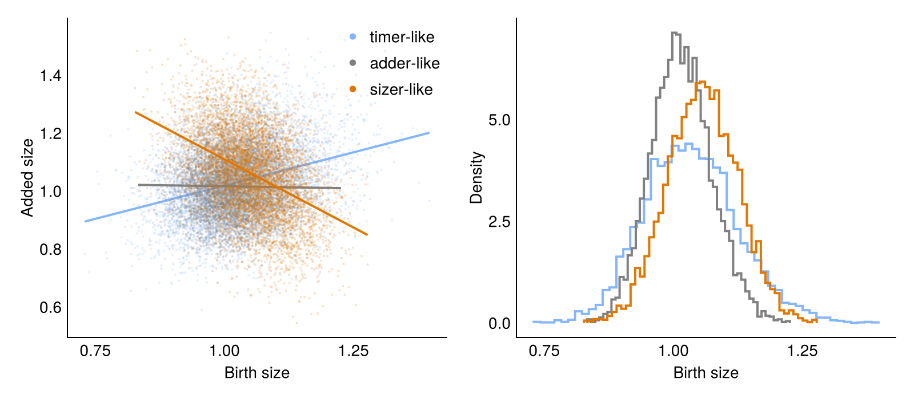

# Threshold-Triggered Division

This model is based on ElGamel & Mugler, "Effects of molecular noise on cell size control",
Phys. Rev. Lett. (2024).

Cells grow exponentially and divide once a molecule `x` reaches a threshold. The molecule
is produced at rate `ν + μV`, where `V` is the cell volume, and degraded at rate `λ`.
Depending on these rates, this can result in cells that behave like timers, adders or sizers.

## The model

````julia
using Catalyst

rn = @reaction_network begin
    @species x(t)
    @variables V(t)
    @parameters α ν μ λ N

    ν + μ * V, 0 --> x
    λ, x --> 0

    @equations begin
        D(V) ~ α * V
    end
end
````

````
Model ##ReactionSystem#313:
Unknowns (2): see unknowns(##ReactionSystem#313)
  x(t)
  V(t)
Parameters (5): see parameters(##ReactionSystem#313)
  α
  ν
  μ
  λ
  N
````

## Division

The cell divides once `x` reaches the threshold `N`. At division, the volume is halved and each daughter
starts with `N / 2` molecules.

````julia
using Chemostats

cb_div = Chemostats.DivideCallback(rn.x ~ rn.N; discrete = true)

function divide_cell(int)
    V = int[:V]
    N = int.ps[:N]

    [ (u0 = [:V => V / 2, :x => N / 2], p = nothing),
      (u0 = [:V => V / 2, :x => N / 2], p = nothing) ]
end;
````

We tell Chemostats to record the birth and division size of each cell by overriding
`Chemostats.get_data`:

````julia
function Chemostats.get_data(cell::DECell{I,typeof(divide_cell)}) where {I}
    V = cell.int.sol[:V]
    (V_b = V[1], V_d = V[end])
end;
````

We create a HybridProblem to simulate the cells. The volume `V` follows an ODE, and `x` changes by jumps.
`VR_Direct` assumes that time starts at 0, so each cell runs on its own clock (`reset_t = true`).

````julia
using OrdinaryDiffEqTsit5
using JumpProcesses

function create_population(rates, L)
    p = [ :α => 1.0, :ν => rates.ν, :μ => rates.μ, :λ => rates.λ, :N => 200 ]
    u0 = [ :V => 1.0, :x => 100.0 ]

    prob = HybridProblem(rn, u0, (0., Inf), p; callback = cb_div, vr_aggregator = VR_Direct(),
                         save_positions = (false, false))

    [ DECell(prob, Tsit5(), divide_cell; reset_t = true) for _ in 1:L ]
end;
````

## Simulation

We simulate `L` lineages using `Chemostats.Forward` for three choices of rates, and compute the
noise in the birth size.

````julia
using Statistics

regimes = [ "timer-like" => (ν = 80.0, μ = 44.0, λ = 0.01),
            "adder-like" => (ν = 2.0, μ = 98.0, λ = 0.01),
            "sizer-like" => (ν = 2.0, μ = 1000.0, λ = 10.0) ]

L = 50
tmax = 100.0
t_burn = 20.0

# Birth and division sizes of the cells that divided after the burn-in
function cell_sizes(rates)
    chem = Chemostats.simulate(create_population(rates, L), tmax, Chemostats.Forward(L);
                               save_mode = :full)

    [ node.data for node in values(chem.tree) if node.t_birth >= t_burn && !node.alive ]
end

sizes = [ cell_sizes(rates) for (name, rates) in regimes ]
births = [ [ s.V_b for s in sz ] for sz in sizes ]
noise = [ name => var(b) / mean(b)^2 for ((name, rates), b) in zip(regimes, births) ]
````

````
3-element Vector{Pair{String, Float64}}:
 "timer-like" => 0.007589634056944953
 "adder-like" => 0.003336576894614688
 "sizer-like" => 0.004118653927780263
````

## Results

```@raw html
<details><summary>Plotting code</summary>
```

````julia
using CairoMakie
set_theme!(theme_minimal())

colors = [ colorant"#85b5fb", :gray, colorant"#e07700" ]

fig = Figure(size = (800, 350))
ax = Axis(fig[1, 1]; xlabel = "Birth size", ylabel = "Added size")
ax2 = Axis(fig[1, 2]; xlabel = "Birth size", ylabel = "Density")

for ((name, rates), sz, color) in zip(regimes, sizes, colors)
    V_b = [ s.V_b for s in sz ]
    ΔV = [ s.V_d - s.V_b for s in sz ]
    slope = cov(V_b, ΔV) / var(V_b)
    xs = collect(extrema(V_b))

    scatter!(ax, V_b, ΔV; color = (color, 0.2), markersize = 3, label = name => (; markersize = 8, color))
    lines!(ax, xs, mean(ΔV) .+ slope .* (xs .- mean(V_b)); color, linewidth = 2)
    stephist!(ax2, V_b; bins = 50, normalization = :pdf, color, linewidth = 2)
end
axislegend(ax; position = :rt);
````

```@raw html
</details>
```



---

*This page was generated using [Literate.jl](https://github.com/fredrikekre/Literate.jl).*

